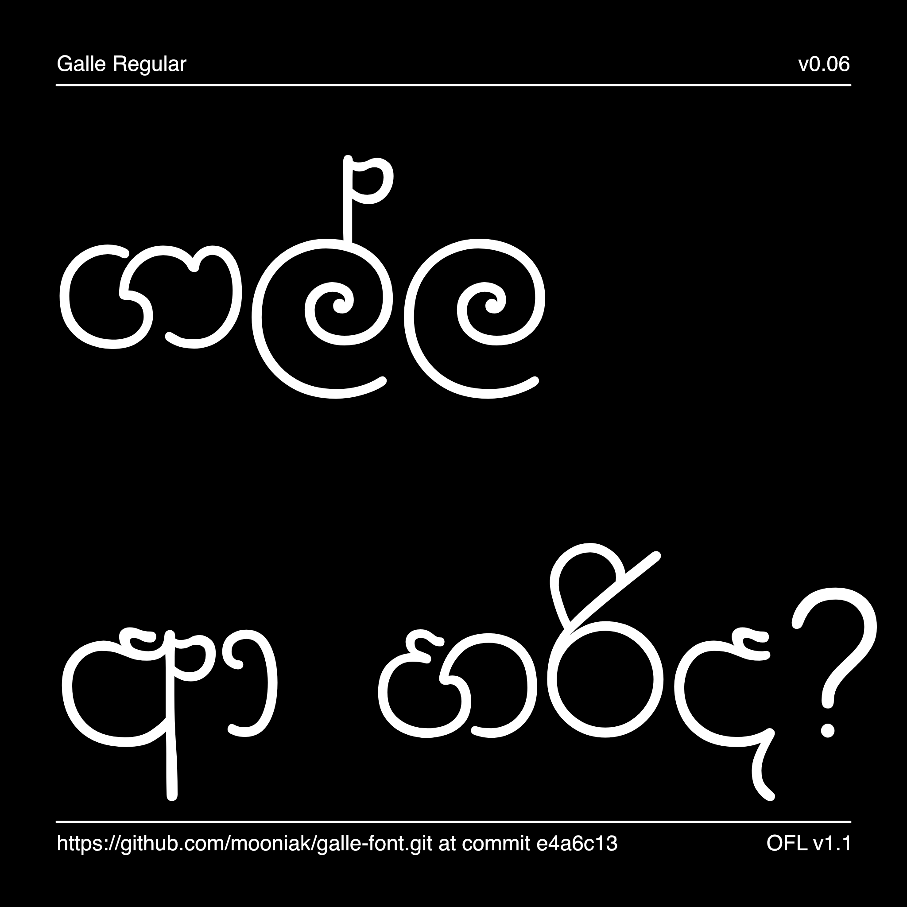
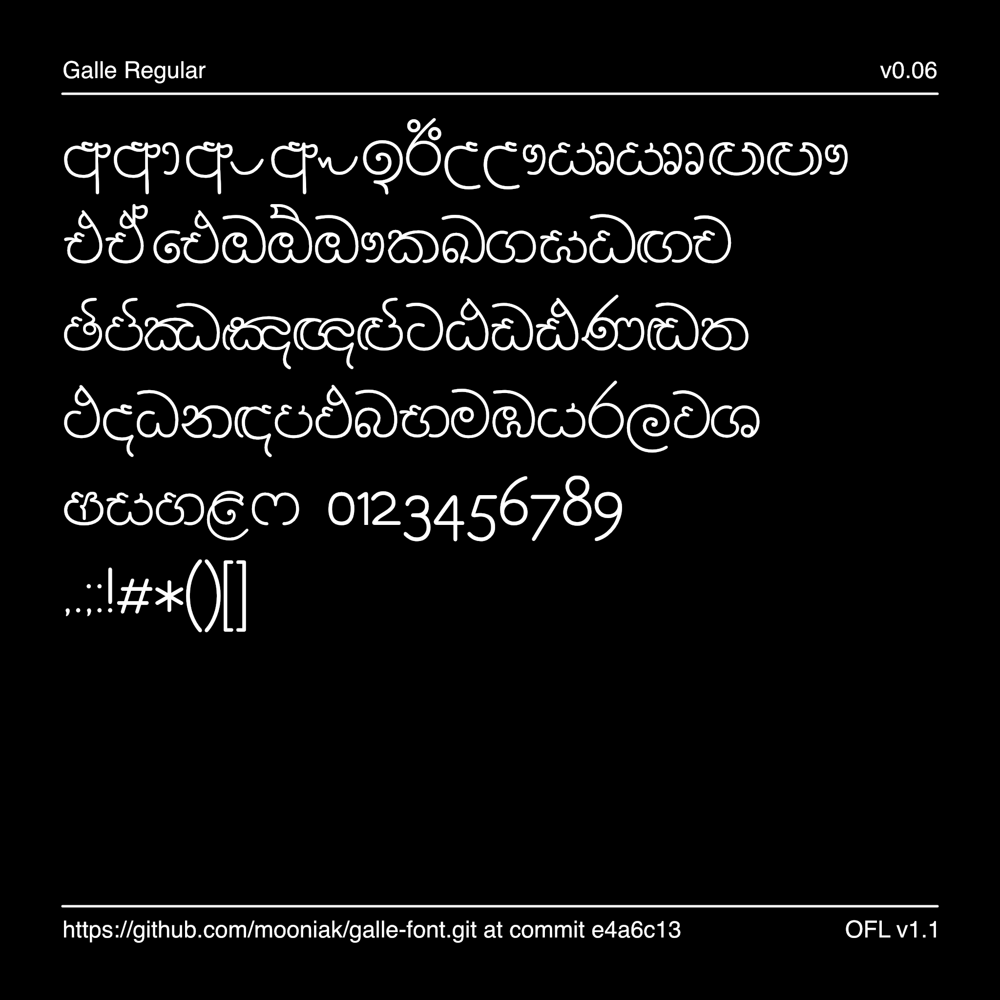

# Galle Fonts; Reviving typefaces of the Dutch Press in Ceylon

[![Build][badge-build]][link-build]
[![Fontspector QA][badge-qa]][link-qa]
[![Release][badge-release]][link-release]
[![License: OFL 1.1][badge-license]][link-license]

[badge-build]: https://github.com/mooniak/galle-font/actions/workflows/build.yaml/badge.svg?branch=dev
[badge-qa]: https://img.shields.io/badge/dynamic/json?url=https%3A%2F%2Fsrc.mooniak.com%2Fgalle-font%2Fbuild.json&query=%24.qa.pass_rate&suffix=%25&label=fontspector%20QA%20(dev%20build)&color=informational
[badge-release]: https://img.shields.io/github/v/release/mooniak/galle-font?label=release
[badge-license]: https://img.shields.io/badge/license-OFL--1.1-green
[link-build]: https://github.com/mooniak/galle-font/actions/workflows/build.yaml
[link-qa]: https://src.mooniak.com/galle-font/reports/fontspector/fontspector-report.html
[link-release]: https://github.com/mooniak/galle-font/releases
[link-license]: OFL.txt

Galle is a Sinhala typeface (Sinh) based on the typefaces used by the Dutch Press in Ceylon, drawn by Janaka Attanayake and Rajitha Manamperi. It is published by [Mooniak](https://mooniak.com/) as a free font under the SIL Open Font License, as part of the Dutch-Sri Lankan shared typography heritage project.

The central repository for the fonts from Dutch-Sri Lankan shared typography heritage project; reviving the typefaces from the Dutch Press in Ceylon (1730–1796). This is a collaborative project managed by Mooniak.

## About
This project started as a side project at Mooniak in 2014 with some help and insight from Dr Sumanthri Samarawickrama. In 2016 Janaka Attanayake initiated an independent revival of the Sinhala typeface under the name Svasthi for partial fulfilment of his Comprehensive Design Project for Bachelor of Design degree program at the Department of Integrated Design, University of Moratuwa.

In 2017 Mooniak in collaboration with Janaka setup this project to complete the Sinhala typeface and release it under an open license for broader use. In 2018 the Embassy of the Kingdom of the Netherlands in Sri Lanka provided partial funding to expand the project into reviving Tamil typefaces from the Dutch Press. Now the project aims to produce a complete set of Sinhala, Tamil and Latin fonts based on the original types from the Dutch Press in Ceylon.

More information, research and documentation [here](http://textual.press/tag/dutch-press-typography/)
